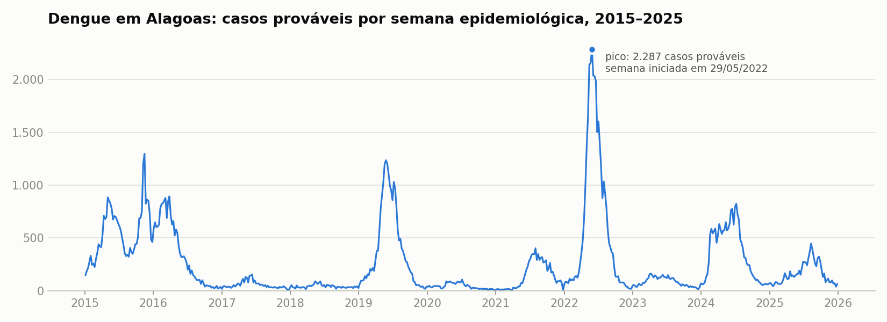
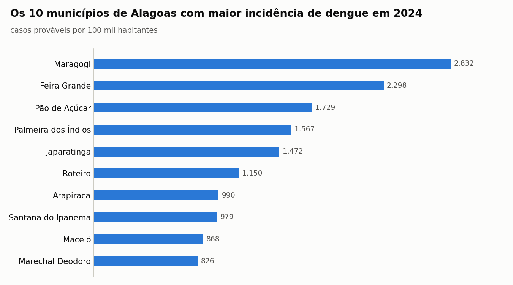

# Monitor de dengue em Alagoas

Série semanal de dengue dos 102 municípios de Alagoas, de 2015 a 2025, preparada para virar um sistema de alerta para a vigilância epidemiológica.

**Etapa atual: E1, download e qualidade dos dados.** Projeto desenvolvido durante o curso de ciência de dados da EBAC.



## Pergunta

Em que semana um município de Alagoas sai do padrão esperado de dengue? A vigilância epidemiológica e o controle de vetores precisam dessa resposta cedo para agir. Esta primeira etapa monta e checa a base; as próximas constroem o canal endêmico e o alerta.

## Quem usaria

Equipes de vigilância epidemiológica e de controle de vetores dos municípios e do estado.

## Dados

| Fonte | O que traz | Acesso |
|---|---|---|
| [InfoDengue](https://info.dengue.mat.br/) (Fiocruz e FGV) | casos de dengue por semana epidemiológica e município: notificados, prováveis (notificados menos descartados) e estimados com correção do atraso de notificação; nível de alerta; temperatura e umidade | [API `alertcity`](https://info.dengue.mat.br/services/api/doc) |
| [IBGE – SIDRA](https://sidra.ibge.gov.br/) | população por município: estimativas anuais (tabela 6579) e Censo 2022 (tabela 4709) | [API SIDRA](https://apisidra.ibge.gov.br/) |
| IBGE – Localidades | lista oficial dos municípios de Alagoas | [API de localidades](https://servicodados.ibge.gov.br/api/docs/localidades) |

Os números desta versão vêm do download feito em 09/11/2026. O InfoDengue revisa a série retroativamente, então um novo download pode mudar os valores. Os dados são públicos; cite as fontes ao reutilizar.

## Método (E1)

1. Lista dos 102 municípios de Alagoas pela API de localidades do IBGE.
2. Série semanal de 2015 a 2025 de cada município no InfoDengue.
3. População de cada município por ano no IBGE. 2023 não tem estimativa oficial e foi interpolado entre o Censo 2022 e a estimativa de 2024.
4. Limpeza e checagens: municípios, semanas por município, buracos na série, duplicatas, valores nulos e anos sem população.
5. Incidência anual de casos prováveis por 100 mil habitantes, o critério dos boletins do Ministério da Saúde, com a população do IBGE de cada ano.

## Resultados da E1

**Qualidade da base.** Os 102 municípios vieram completos: 574 semanas cada, da semana 1 de 2015 à semana 53 de 2025, sem buracos, duplicatas ou valores negativos. Só as colunas de clima têm valores nulos (1,9% em temperatura e 2,8% em umidade).

**O denominador muda o resultado.** De 2015 a 2022, a coluna de população do InfoDengue repete a estimativa do IBGE para 2020 (a soma do estado bate exatamente: 3.351.543 habitantes). Em 2022, isso fica 7% acima do Censo 2022. No município com a maior diferença, Campo Alegre, a população usada pelo InfoDengue em 2022 era 79% maior que a contada pelo Censo. Por isso a incidência deste projeto usa a população do IBGE de cada ano.

**Casos prováveis e incidência em Alagoas**

| Ano | Casos prováveis | Incidência por 100 mil hab. |
|---|---:|---:|
| 2015 | 28.370 | 849,2 |
| 2016 | 17.881 | 532,3 |
| 2017 | 2.910 | 86,2 |
| 2018 | 2.221 | 66,8 |
| 2019 | 20.894 | 626,1 |
| 2020 | 2.318 | 69,2 |
| 2021 | 7.337 | 218,0 |
| 2022 | 32.337 | 1.033,9 |
| 2023 | 4.431 | 139,6 |
| 2024 | 19.222 | 596,9 |
| 2025 | 8.618 | 267,6 |

A semana com mais casos prováveis no período começou em 29/05/2022, com 2.287 casos no estado. Esses totais ainda precisam ser conferidos com o TabNet do DATASUS (o passo está no notebook).



Em 2024, 6 dos 10 municípios com maior incidência tinham menos de 50 mil habitantes. Nesses municípios poucos casos mudam muito a taxa, e a etapa E3 vai tratar essa instabilidade.

## Limitações

- Subnotificação: a base só enxerga os casos que chegaram a ser notificados.
- As semanas mais recentes são preliminares, porque o InfoDengue atualiza a série retroativamente toda semana.
- 2020 e 2021 podem ter subnotificação ligada à pandemia.
- Caso provável não é caso confirmado em laboratório.
- Os dados são agregados por município e não permitem conclusões sobre indivíduos.
- A população de 2023 é interpolada, e há um degrau entre as estimativas até 2021 (projeções do Censo 2010) e o Censo 2022.

## Como reproduzir

Requer Python 3.10 ou mais recente. No Windows, use `py` no lugar de `python`.

```bash
py -m pip install -r requirements.txt
py src/baixar_infodengue.py
py src/baixar_populacao.py
py src/preparar_dados.py
```

O download do InfoDengue leva cerca de 4 minutos. Depois, abra `notebooks/01_qualidade.ipynb` no Jupyter, no VS Code ou no Google Colab.

## Estrutura

```text
├── data/
│   ├── raw/          # dados baixados (fora do Git; os scripts baixam de novo)
│   └── processed/    # base semanal, base anual e resumo das checagens
├── notebooks/        # 01_qualidade.ipynb
├── reports/figures/  # gráficos usados neste README
└── src/              # scripts de download e preparo
```

## Próximos passos

- **E2 · visualização:** mapa de calor município × semana e mapa da incidência anual.
- **E3 · estatística:** canal endêmico por município e lista das semanas acima do limite.
- **E4 · machine learning (opcional):** previsão de casos com 4 semanas de antecedência.
- **Painel:** monitor em Streamlit com seletor de município.
